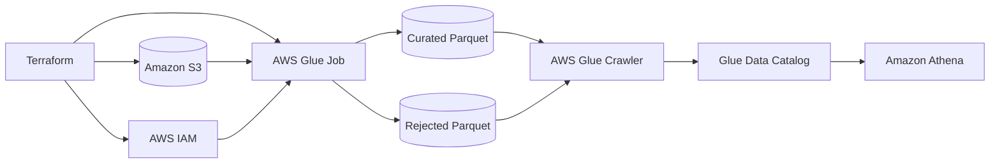

# Reusable AWS Glue ETL Pipeline with Terraform

[](https://developer.hashicorp.com/terraform)
[](https://registry.terraform.io/providers/hashicorp/aws/5.100.0)
[](LICENSE)

A reusable Infrastructure as Code template for a serverless data-quality
pipeline on AWS. Terraform provisions the infrastructure, AWS Glue runs a
PySpark validation job, a crawler registers the Parquet outputs in the Glue
Data Catalog, and Amazon Athena reconciles the results with SQL.

## Proven result

The reference execution in an AWS sandbox produced:

| Metric | Result |
|---|---:|
| Source records | 5,000 |
| Valid records | 4,842 |
| Rejected records | 158 |
| Reconciliation | 5,000 |
| Glue execution | SUCCEEDED in 87 seconds |
| Terraform resources | 11 created / 11 destroyed |

The dataset is synthetic and included only for demonstration.

## Architecture



## What Terraform creates

- Private S3 bucket with public access blocked and AES-256 encryption.
- Uploads for the sample CSV and PySpark job.
- IAM role for Glue plus project-scoped S3 access.
- AWS Glue 6.0 job with two G.1X workers.
- Glue crawler with curated and rejected S3 targets.
- Glue Data Catalog database.

## Repository structure

```text
.
|-- .github/workflows/terraform-checks.yml
|-- data/sales_transactions_raw.csv
|-- glue/glue_sales_etl.py
|-- sql/validation_queries.sql
|-- glue.tf
|-- iam.tf
|-- main.tf
|-- outputs.tf
|-- terraform.tfvars.example
|-- variables.tf
`-- versions.tf
```

## Prerequisites

- AWS account with permission to create the documented resources.
- AWS CLI authenticated for the target account.
- Terraform 1.17.0.
- AWS Provider 5.100.0, downloaded by `terraform init`.

Check the active AWS identity before deployment:

```bash
aws sts get-caller-identity
```

## Quick start

1. Clone the repository and enter its directory.
2. Create your local variable file:

   ```bash
   cp terraform.tfvars.example terraform.tfvars
   ```

3. Edit `terraform.tfvars`. Use a unique `project_name`. Keep
   `force_destroy = false` for persistent environments. Set it to `true` only
   for a disposable lab where automatic cleanup is required.
4. Initialize, format, validate, and review the plan:

   ```bash
   terraform init
   terraform fmt -check -recursive
   terraform validate
   terraform plan -out=tfplan
   ```

5. Deploy only after reviewing the plan:

   ```bash
   terraform apply tfplan
   ```

## Run the pipeline

Start the Glue job and capture its execution ID:

```bash
ETL_JOB_RUN_ID=$(aws glue start-job-run \
  --job-name "$(terraform output -raw glue_job_name)" \
  --query JobRunId \
  --output text)

echo "$ETL_JOB_RUN_ID"
```

Check its status:

```bash
aws glue get-job-run \
  --job-name "$(terraform output -raw glue_job_name)" \
  --run-id "$ETL_JOB_RUN_ID" \
  --query 'JobRun.[JobRunState,CompletedOn,ExecutionTime,ErrorMessage]' \
  --output table
```

After the job reaches `SUCCEEDED`, start the crawler:

```bash
aws glue start-crawler --name "$(terraform output -raw crawler_name)"
```

Wait until the crawler returns to `READY` and `LastCrawl.Status` is
`SUCCEEDED`:

```bash
aws glue get-crawler \
  --name "$(terraform output -raw crawler_name)" \
  --query 'Crawler.[State,LastCrawl.Status,LastCrawl.StartTime,LastCrawl.Message]' \
  --output table
```

## Validate with Athena

Use these Terraform outputs:

```bash
terraform output -raw catalog_database
terraform output -raw athena_results_uri
```

Configure the Athena workgroup result location with `athena_results_uri`,
select the returned catalog database, and execute the queries in
`sql/validation_queries.sql`.

The reconciliation query verifies:

```text
valid rows + rejected rows = source rows
4,842 + 158 = 5,000
```

## Verify idempotency

After deployment and execution, run:

```bash
terraform plan
```

The expected infrastructure result is `No changes`.

## Cleanup

Review the destruction plan before confirming:

```bash
terraform plan -destroy
terraform destroy
```

Terraform cannot delete a non-empty S3 bucket when `force_destroy = false`.
Delete or preserve the objects intentionally before cleanup, or use
`force_destroy = true` only in a disposable sandbox.

## Reuse and extension

Change `project_name`, `owner`, `aws_region`, and the input data to create an
independent deployment. The PySpark job can be extended with new quality rules,
sources, partitions, or business transformations.

A logical next phase is to create a feature table from the curated dataset and
train a classification model for cancellation-risk prediction while preventing
data leakage and tracking model versions and metrics.

## Cost and security notes

- Glue jobs and Athena queries can incur charges. Destroy unused lab resources.
- The S3 bucket is private and encrypted, but organizational requirements may
  require KMS keys, access logging, VPC endpoints, or additional controls.
- Do not commit AWS credentials, `terraform.tfvars`, state files, or plans.
- For team environments, use a protected remote Terraform state backend with
  locking rather than local state.

## Tested versions

- Terraform 1.17.0
- HashiCorp AWS Provider 5.100.0
- AWS Glue 6.0
- Region used by the reference lab: `us-east-1`

## Author

Miguel Fuentes — Data Engineering, databases, cloud infrastructure, and
automation.

## License

Released under the [MIT License](LICENSE).
